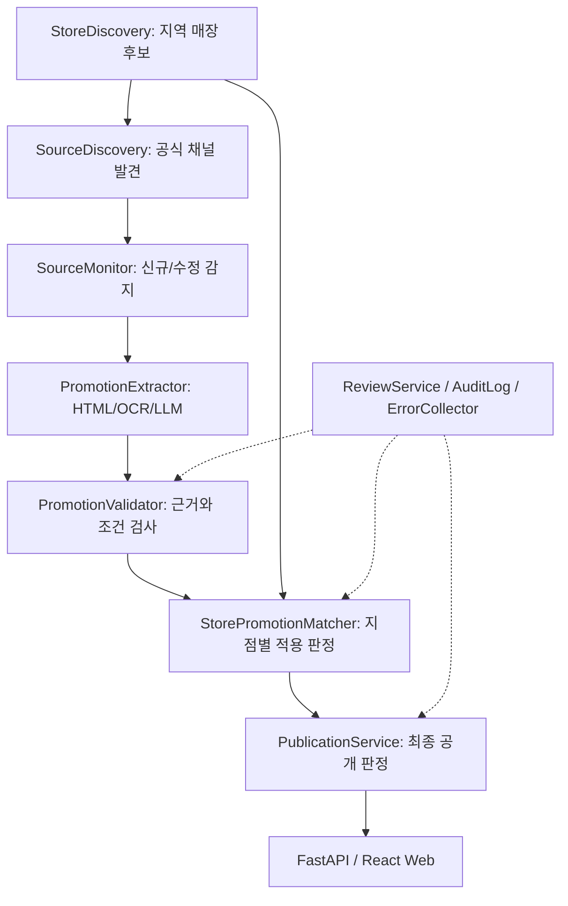

# 4 DDALLA — System Architecture

- Version: 1.0.0
- Status: BASELINED (design only)
- Last updated: 2026-11-11

## 1. 설계 목표

비실시간 할인정보 배치 처리, 무료/저비용 운영, 로컬 PC 자원 활용, 공급자 교체 가능성, 고신뢰 검증·감사, 로컬 PC가 꺼져 있어도 웹 서비스 조회 지속.

## 2. 기준 기술 스택

| 계층 | 선정 기술 및 상태 |
|---|---|
| Frontend | React + TypeScript + Vite (권장 기준선) |
| Backend | Python + FastAPI + Pydantic |
| Database | PostgreSQL + PostGIS |
| Background tasks | PostgreSQL 작업 큐 + Python 워커, 초기 Redis/Celery 불필요 |
| OCR | `OCRProvider` 인터페이스, 실모델 POC 후 결정 |
| LLM | `LLMProvider` 인터페이스, 로컬·외부 모델 교체 가능 |
| 지도/장소검색 | 공급자 미정, 약관·표시·보관·AI 활용권 검증 후 선택 |
| Hosting | 미정 |
| 개발 에이전트 | OpenCode + EXAONE 2.5 (런타임 OCR/LLM과 별개) |

## 3. 핵심 파이프라인

- StoreDiscovery: 매장/브랜드 식별, 장소 공급자 라이선스 반영.
- SourceDiscovery: 공식성 증거와 허용된 수집 방식 별도 판정.
- SourceMonitor: 목록 및 진행 행사 재점검, 콘텐츠 버전·체크포인트.
- PromotionExtractor: HTML 우선, 필요 시 OCR·LLM으로 구조화.
- PromotionValidator: 가격·기간·조건·근거 검증, 불확실하면 검수.
- StorePromotionMatcher: 브랜드/지점 범위·포함/제외·조건 분리.
- PublicationService: 최종 공개/숨김/예정/미확인 결정. 사용자 요청에서 AI 금지.

## 4. 서버와 로컬 PC 역할

**서버(운영 시 상시 가동):** 업무·검수 상태, 작업 등록·결과 수신, 최종 계약 검증, 데이터 저장, 게시·비공개 판정, 조회·제보 API, 인증/권한, 운영자 대시보드.

**로컬 PC(켜져 있을 때만):** 허용된 수집 작업, 이미지 OCR, 로컬 LLM 구조화, 대량 재분석, 후보·근거와 오류 보고. 분석 결과를 **직접 공개 DB에 반영하거나 사용자에게 제공하지 않는다.**

첫 버전은 로컬 전체 실행 및 선택적 **배치 결과 업로드**부터 POC. 운영 환경의 복잡한 원격 워커 조율은 실제 필요 시 도입한다. 로컬 PC가 꺼진 동안 서버는 마지막 검증 데이터의 기간/최신성을 재평가하고, 기한 초과 또는 차단 행사 노출을 막는다.

## 5. 작업 큐·복구

- 각 작업: UUID, 입력 버전, 계약 버전, 멱등성 키, 시도 기록, 임대(lease) 만료, 다음 실행 시각.
- 작업 할당은 짧은 트랜잭션에서 동시성 안전하게 처리한다. 외부 요청 중 긴 DB 트랜잭션 금지.
- 관측 결과 저장, 후속 작업 발행 및 체크포인트 전진은 원자적으로 처리한다.
- 실패 시 백오프·재시도 한도·관리자 오류 로그. 동일 작업 재시도로 중복 행사 생성 금지.
- 모든 오류 발생 건 기록; 알림은 심각도별로 제한·중복 억제.

## 6. 보안·외부 데이터 권한

외부 입력 및 로컬 워커 결과는 비신뢰. URL 요청은 SSRF 방어(내부망/localhost/메타데이터 IP/리다이렉트), 응답 크기/시간 제한, 접근 정책 검사. 페이지의 프롬프트 인젝션 무시. 키·토큰 비밀 관리, 로그 민감정보 제거. 출처별 저장·재사용·상업적 표시·외부 AI 처리 권한을 확인한다. `robots.txt`만으로 사용권을 추정하지 않는다.

## 7. 시각·캐시 정책

UTC 기준 DB `TIMESTAMPTZ`, 한국 사용자 표시는 Asia/Seoul. `last_collected_at`, `last_verified_at`, `next_verification_due_at`, `published_at` 구분. 데이터 캐시와 사용자 응답 캐시 분리; 기간·시간대 경계, 관리자 비공개, 원본 변경 시 안전하게 무효화.

## 8. 확장 기준

초기부터 Kubernetes, Redis, Celery를 넣지 않는다. 실제 워커 지연·작업량·비용·장애를 측정한 뒤 증설 여부 판단. 실제 서비스용 공급자·호스팅·모델은 미정 상태 유지.
